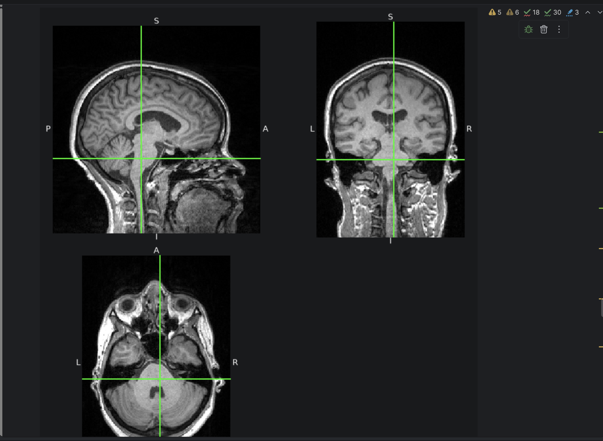
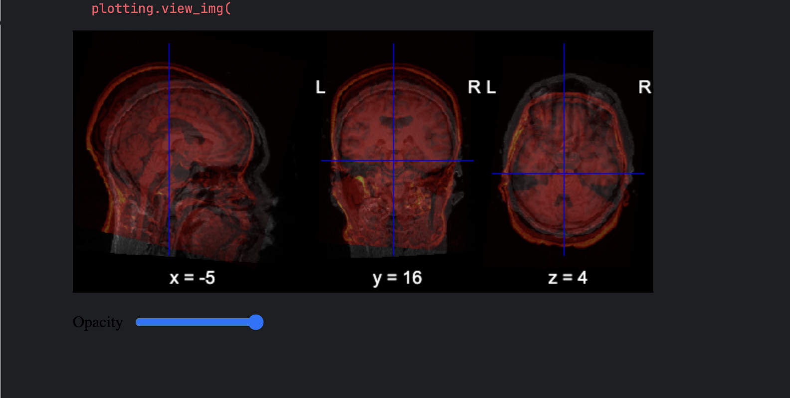

# 1. DICOM, NIfTI and BIDS

Each DICOM file holds one 2D slice plus acquisition metadata (3 T Siemens TrioTim). DICOM stores times in ms: TR = 1950 ms, TE = 2.26 ms.

**Acquisition 4 vs 16.** Acquisition 4 is a T1w MPRAGE: 3D, 1 mm isotropic, 176 slices, TR/TE 1950/2.26 ms. Acquisition 16 is DTI with 63 directions: 2D EPI, 2 mm isotropic, 64 MOSAIC volumes, TR/TE 9200/92 ms, plus b-values and b-vectors.

**JSON with pydicom.** `dicom2nifti` writes no `.json`, so I built the sidecar from the DICOM header (manufacturer, field strength, TR/TE in seconds, flip angle, slice thickness). `dcm2niix` writes it automatically, and `-f` controls the file name.

**BIDS.** I converted all 5 DICOM sessions with `dcm2niix` into `BIDS-mine/sub-CONxx/ses-*/{anat,dwi}`. `sub-CON01` has only a T1w scan. All 29 files pass `BIDSValidator().is_bids()`.

**Missing files.** Only `dataset_description.json` (with `Name` and `BIDSVersion`) is required. `README`, `CHANGES`, `participants.tsv` and `participants.json` are recommended. Every image also needs a JSON sidecar, and DWI needs `.bval`/`.bvec`.

# 2. Visualization and the affine

`sub-CON01` T1w: 176 × 256 × 256 voxels, 1 mm, RAS orientation.

{width=60%}

{width=75%}

The two scans have different affines. The same voxel (60, 140, 140) is at (-26.2, 44.4, 40.8) mm in `sub-CON01` and at (-27.7, 58.2, 27.4) mm in `sub-CON02`. Each scan is in its own subject space, so the scans must be registered before they can be compared.

**Why nilearn uses the NIfTI object.** The object carries the affine (voxel $\to$ mm). Nilearn uses it to place, resample and overlay images. A plain numpy array has no spatial information.

# 3. FSL: brain extraction, segmentation, registration

FSL 6.0.7.23 was run on `sub-CON01`.

{width=85%}

{width=85%}

{width=85%}

All three methods are unsupervised. `bet` uses a deformable surface, `fast` uses a Gaussian mixture with an MRF and bias-field correction, and `flirt` optimizes an image-similarity cost (correlation ratio).
